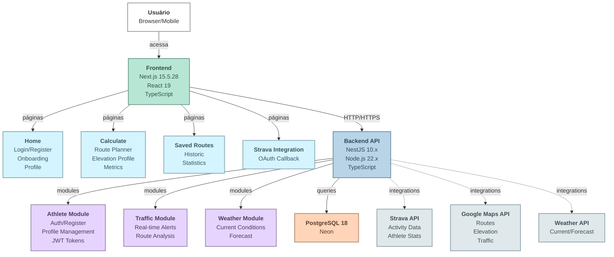

  

 

  

---

## sumário

- [📊 Fluxograma geral](#fluxograma-geral)
- [🛠️ Quick start](#quick-start)
- [📌 Requisitos e regras](#requisitos)
- [🚢 Deploy](#deploy)

---

Aplicação backend desenvolvida em NestJS para estimar tempo de percurso, distância, calorias gastas e ganho/perda de elevação com base na velocidade média real do ciclista.
O sistema integra dados do Strava (velocidade média geral) e do Google Maps (distância e rota), proporcionando cálculos personalizados para ciclistas de diferentes modalidades (MTB, Speed, etc.).

- 🎯 **Status**: Concluído (v1).
- 🎯 **Próximos passos**: Melhorias para v2.

---

## 📊 Fluxograma geral

---

## 🛠️ Como começar (quick start)

este guia reúne o básico para instalar, configurar e rodar o backend localmente:
- [docs/quick-start.md](docs/quick-start.md)

---

## 📌 Requisitos e regras de negócio do velox

#### objetivo da v1:

permitir ao usuário calcular o tempo estimado e o gasto calórico de uma rota ciclística com base em sua velocidade média e dados pessoais, de forma manual ou integrada com o strava.

para rf, rnf e regras de negócio, mais infos na doc:

- [docs/v1/requirements.md](docs/v1/requirements.md)

---

## 🚢 Deploy

hospedagem 100% no plano gratuito:

| parte | onde | observação |
|-------|------|------------|
| api | render (free web service), região virginia | dorme após 15 min sem requisição; a primeira requisição depois disso leva ~1 min |
| banco | neon (free), projeto `velox`, branch `production`, aws us-east-1 | postgres 18, 0,5 gb; tabelas criadas pelo `synchronize: true` |
| front | vercel (hobby), `https://web-velox.vercel.app` | ver o [readme do front](https://github.com/htamagnus/web-velox#-deploy) |

### render

| campo | valor |
|-------|-------|
| build command | `npx pnpm@9 install --frozen-lockfile && npx pnpm@9 run build` |
| start command | `npm start` |
| health check path | `/status` |

- pnpm fixo na 9: a partir do pnpm 10 os scripts de instalação das dependências não rodam por padrão, e o binário do `bcrypt` não é gerado (`Cannot find module bcrypt_lib.node`).
- variáveis de ambiente: as mesmas do `.env`, com os `DB_*` do neon (conexão direta, host sem `-pooler`) e `ALLOWED_ORIGINS` com a url do front. `PORT` não é definida, o render injeta.
- deploy automático a cada push na `main`.

### google maps (gcp, projeto `velox-474919`)

o plano grátis do google maps é uma cota mensal por api, e só vale com a conta de faturamento ativa. para nunca passar dela, cada api usada tem limite diário (cota grátis ÷ 31):

| api | cota limitada | grátis/mês | limite/dia |
|-----|---------------|------------|------------|
| Directions API | Requests per day | 10.000 | 320 |
| Distance Matrix API | Elements per day | 10.000 | 320 |
| Maps Elevation API | Requests per day | 5.000 | 160 |
| Maps JavaScript API | Map loads per day | 10.000 | 320 |
| Places API (New) | AutocompletePlacesRequest per day e GetPlaceRequest per day | 10.000 cada | 320 cada |

uma chave para cada lado, cada uma liberada só para as apis que usa:

| chave | onde | apis liberadas | restrição de aplicativo |
|-------|------|----------------|-------------------------|
| `velox-back` | render (`GOOGLE_MAPS_API_KEY`) | Directions, Distance Matrix, Maps Elevation | nenhuma: chamadas do servidor não têm site de origem |
| `velox-app` | vercel (`NEXT_PUBLIC_GOOGLE_MAPS_API_KEY`) | Maps JavaScript, Places API (New), Directions | sites: `https://web-velox.vercel.app/*` e `http://localhost:3000/*` |

- ao bater o limite, a api devolve erro em vez de cobrar.
- alerta de orçamento de R$ 5 na conta de faturamento.
- usar uma api nova do google no código exige liberá-la na chave do lado que chama e definir o limite diário dela.

arquitetura anterior (aws): [docs/deploy-architecture.md](docs/deploy-architecture.md)
